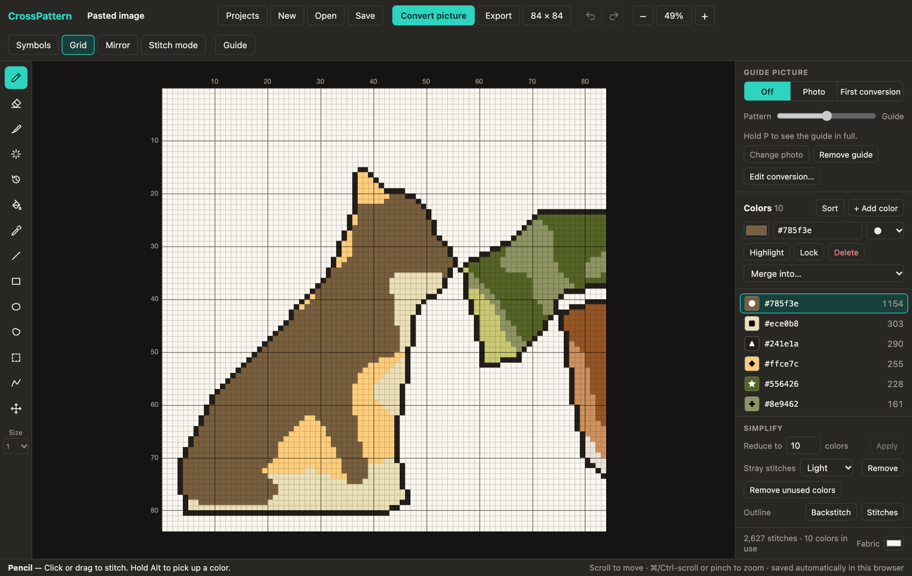
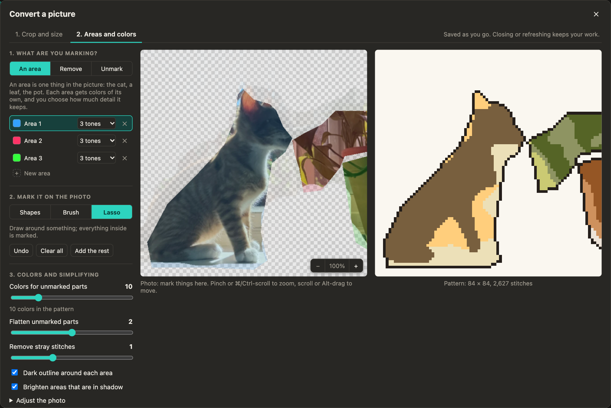
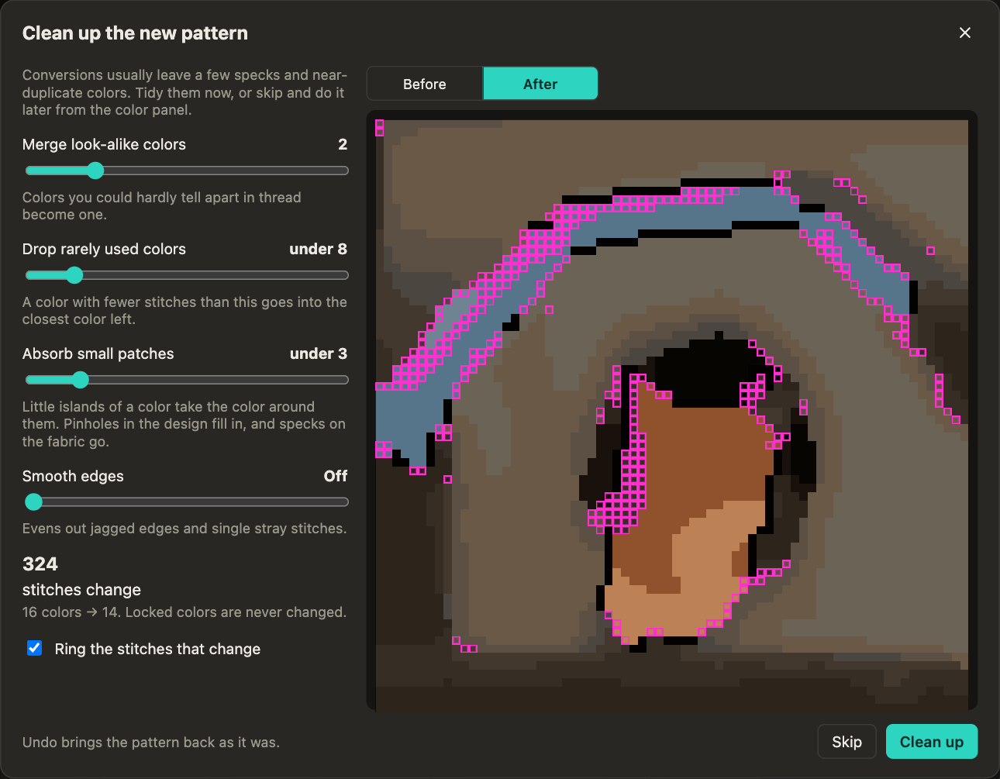
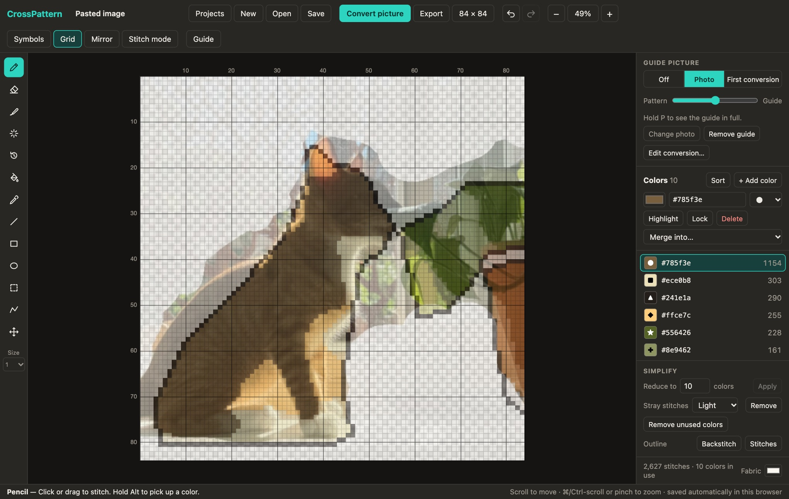
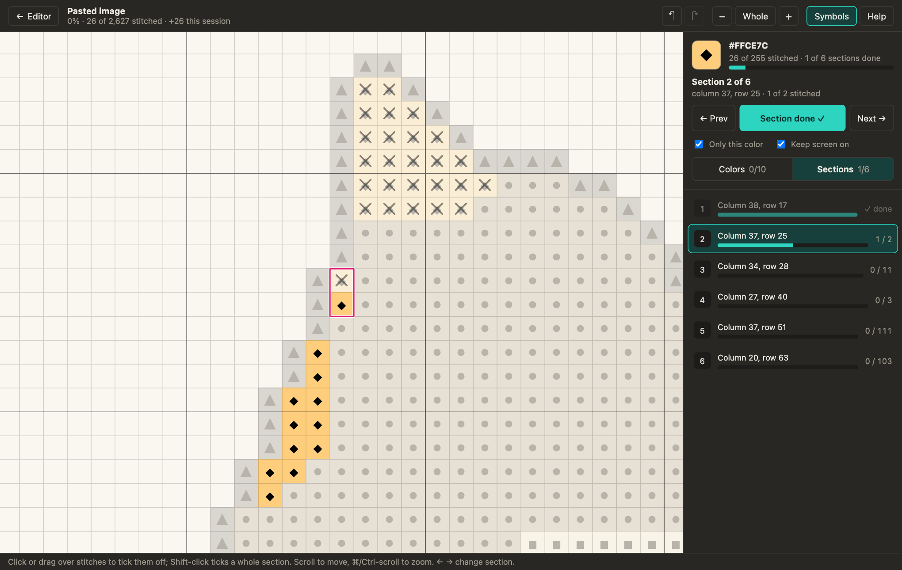
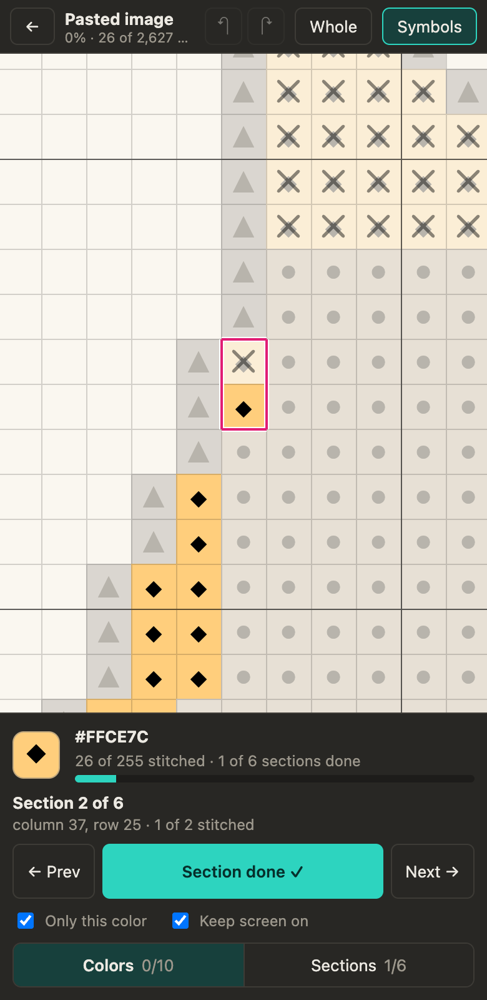
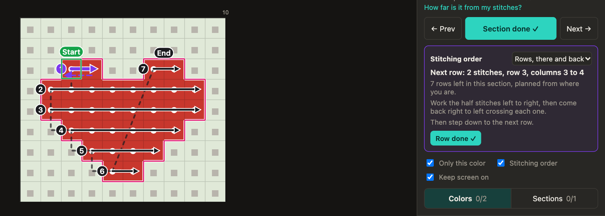

# CrossPattern

A cross stitch pattern editor that runs in your browser. Draw on a grid, or turn a photo into a pattern and
clean it up until it is something you would actually want to stitch.

**Use it here: https://lbare.github.io/CrossPattern/**

There is nothing to install and no account. Your patterns stay in your own browser; nothing is uploaded.



## What it does

- **Grid editor**: pencil, eraser, fill, line, rectangle, ellipse, select and move, and backstitch outlines.
- **Picture conversion**: crop a photo to the exact stitch count you want, select the things that matter with
  a brush that follows edges, give each its own colors, detail and soft or crisp edge, and remove the rest.
- **Fine-tuning**: show the original photo over the pattern, repaint single colors, tidy noisy patches, bring
  back parts of the first conversion, or re-convert just one area with different settings.
- **Colors**: any color you like, each with a chart symbol and a live stitch count. Highlight, lock, merge,
  reduce to a set number of colors, and preview on any fabric color.
- **Stitching**: a screen for working through the pattern color by color and section by section, ticking
  stitches off as you go. Made for using on a phone next to your hoop.
- **Projects**: keep as many patterns as you like in a library, save any of them to a file, or send one to
  your phone with a QR code.
- **Export**: a PNG of the chart, or a multi-page printable chart (also saved as PDF) with a color key.

The same guide is built into the site: press **Guide** in the top bar, or `?`.

## Using it

### Drawing

Pick a color in the panel on the right, pick a tool on the left, and click or drag on the grid. Each square is
one stitch, and bold lines mark every tenth.

| Tool | Key | What it does |
| --- | --- | --- |
| Pencil | `B` | Adds stitches in the current color. |
| Eraser | `E` | Removes stitches. |
| Recolor brush | `C` | Replaces only the color you start on, leaving everything else under the brush alone. |
| Tidy brush | `T` | Absorbs stray stitches into the colors around them, only where you brush. |
| Restore brush | `O` | Paints back stitches from the first conversion of a picture. |
| Fill | `G` | Fills a connected area. Shift-click replaces that color everywhere. |
| Pick color | `I` | Uses the color you click. Shift-click takes the exact shade from the guide photo. |
| Line | `L` | Straight line of stitches. |
| Rectangle | `R` | Outline, or filled with Shift. |
| Ellipse | `U` | Outline, or filled with Shift. |
| Shape select | `S` | Click a patch of color to select all of it, then fill, absorb, erase, grow, shrink, smooth or outline it. |
| Select | `M` | Drag to select, drag inside to move. Flip, rotate, copy, cut, crop from the bar that appears. |
| Backstitch | `K` | Drag between grid corners to add an outline. Alt-click a line to remove it. |
| Move view | `H` | Drag to pan; click a stitch to see its color, symbol and count. Space-drag works with any tool. |

Other useful keys: `[` and `]` change brush size, `0` fits the pattern to the window, `+` and `-` zoom,
`⌘/Ctrl Z` undoes, `⌘/Ctrl A` selects everything, arrow keys nudge a selection, and holding `P` shows the guide
picture in full. **Mirror** in the top bar repeats everything you paint on the other side of the centre line.

### Converting a picture

Press **Convert picture** and choose, drop or paste an image.



1. **Crop and size.** Type the width and height in stitches. The crop box takes that shape; drag it or a corner
   to choose what goes in. You see the total stitch count and the finished size on your fabric count.
2. **Areas and colors.** This works like selecting in a picture editor: select something, then say what it is.

   **Select** with any of three tools. The selection shows in blue.
   - **Shapes**: the photo is split into its obvious shapes for you. Click one, or drag across several.
   - **Smart brush**: paint roughly along something and the brush follows its real edges. Its size is measured
     on screen, so zooming in gives a finer brush; `[` and `]` change it.
   - **Lasso**: draw around something.

   Every tool adds to the selection, or takes away with "Take away" chosen. Shift always adds and Alt always
   takes away. When a stroke ends, its edge **snaps** onto the nearest real edge in the photo, for adding and
   taking away alike. Snap edges, Smooth, Grow, Shrink, Fill gaps and Invert tidy the selection.

   The **Eraser** unmarks part of an area directly: it only erases the area you start on, following the
   photo's edges. **Snap area edges** moves the lines between finished areas back onto the photo's edges where
   one has strayed into the next.

   **Then say what it is**:
   - **New area**: one thing in the picture (the cat, the roof, a wall). Each area has colors of its own and
     its own settings: how much detail it keeps (1 flat color, 2 to 6 tones, or full detail) and whether its
     edge is crisp or soft. "Change" loads an area back as the selection so you can add to it or trim it.
   - **Remove**: leave it as empty fabric. "Remove the rest" does that for everything unmarked.
   - **Unmark**: clear any marks there.

   Then set how many colors the unmarked parts get, how strongly to flatten them, and how much to clear stray
   stitches. "Adjust the photo" lifts shadows and changes brightness, contrast and color strength first.
   Pinch or ⌘/Ctrl-scroll over the photo to zoom in for small features. The window fills the screen, and
   Photo / Both / Pattern chooses what to show, so one picture can have all the room.
3. **Clean up.** Creating the pattern offers to merge look-alike colors, drop rarely used ones, absorb small
   patches and smooth jagged edges, ringing every stitch that would change before anything does. Skip it if you
   like: it is also under Simplify as **Clean up…**, and Undo reverses it.

   

The conversion is saved as you work: close the window or refresh the page and it is still there. A pattern
also remembers the conversion it came from, so "Edit conversion" in the right panel reopens it later.

A good order: select the main subject and make it an area with 3 or 4 tones, add other objects as their own
areas with fewer tones, remove the rest, then adjust each area's detail and edge until it looks right. Because every
area has its own colors, a subject in shadow is not drowned out by a busy background.

### Fine-tuning afterwards

- **Guide picture** (top of the right panel): show the photo or the first conversion over your pattern, with a
  slider to fade between the two. You can also add a photo to trace over on any pattern.

  

- **Shape select**: click any patch of color to work on it as a whole. Absorb makes a stray blob disappear into
  its surroundings, Grow and Shrink move its edge by one stitch, and Smooth edge trims jagged corners.
- **Re-convert**: select an area and press Re-convert to convert just that part of the photo again.
- **Lock** a color so no tool can paint over it while you work around it.
- **Remove backstitch** (under Simplify): remove the backstitch lines in the current color, such as an outline,
  or all of them.
- **Simplify**: Clean up… (see above), reduce to a number of colors, remove stray stitches everywhere, or add an outline around the
  design as backstitch or stitches.
- Click the canvas size in the top bar to resize the canvas or trim empty edges.

### Stitching

When the pattern is ready, press **Stitch ✓**. The stitch screen takes you through the pattern the way most
people stitch: one color at a time, and one section of that color at a time.



- **Pick a color** under Colors. The other colors fade out and only stitches of this color can be ticked
  (untick "Only this color" to see and tick everything).
- **Work section by section.** A section is one separate patch of the color. Sections are numbered from the top
  down, the current one is outlined, and its starting column and row match a printed chart. Next and Prev move
  between them, and **Section done** ticks a whole section and moves to the next unfinished one.
- **Tick single stitches** by tapping or clicking them; again to untick. On a computer, drag across several or
  Shift-click a whole section. Ticked stitches are faded and crossed out, and Undo takes back a tick.
- **Finish a color** and Next color moves on to the next one with stitches left.
- **See the whole pattern's progress**: stitches done out of the total, how many to go, colors finished and
  stitches done this session, with a line along the top that fills as you go. On a phone the total sits under
  the pattern name and the full figures are in the ⋯ menu.
- **Pick up where you left off**: progress is saved as you tick, the color and section you were on are remembered
  for each project, and if you leave the site on the stitch screen it opens there next time.

It is built to be used on a phone next to your hoop. The pattern fills the screen with one slim bar underneath:
the color (tap to change it), ‹ and › for the sections, the section number (tap for the list) and ✓ to tick the
section off. Everything else is in the ⋯ menu. A tap ticks, a drag moves, the screen can be kept from going
dark, and the back button returns to the editor. Ticked stitches keep a lighter shade of their color, with a
cross over them.



On a computer, a label beside the mouse gives the column and row of the square under it (numbered like a printed
chart), with its color and whether it is stitched. ← and → move between sections and Enter ticks the current one off.

**Stitching order** (O, or the ⋯ menu on a phone) draws arrows showing how to work the current section: where to
start, each row in turn with its direction, where to step down to the next row, and where the thread should be
finished off rather than carried more than three squares behind. Rows go from the top down (columns for tall thin
shapes), worked "there and back" (half stitches along the row, then back crossing them) or one cross at a time. The
panel describes the next row and **Row done** ticks it. The plan covers only the stitches not yet ticked and carries
on from the last one you ticked, so stitches done out of order are planned around.



**Thread for this section** estimates the thread for what is left of the section and how to cut it: how many
lengths, how long each, and where to change thread (at a row's end where possible), so you do not run out partway
along a row and the last length is cut just long enough. ✂ marks on the stitching-order arrows show the changes, and
it also gives what is left of the color in skeins. Fabric count, strands, longest length and cm/inches are set in the
box. To begin somewhere other than the suggested start, press **Start somewhere else** and click the square to
start from (it is not ticked); the order is planned again from there, and a square in another section moves you to it.
To keep the pattern uncluttered, only the rows for the thread in your needle are drawn in full; "Whole plan" shows
every row. The estimate is about 13 mm a stitch on 14-count plus about 10 cm a length to start and finish off.

**Up next** suggests what to do after the current section, with the reason:
- **The next section**: the nearest unfinished one to where your thread will be, not the next by number, and
  whether to carry the thread over, slip it under finished stitches on the back, or start a new thread.
- **The next color**: with nothing stitched, the one in the middle of the design (so it is centred on the fabric);
  after that, the one with the most stitches right beside finished ones, so you can count from them.
- **Backstitch last**, on top of the finished crosses.

Section done, Next color and picking a color all follow these suggestions, and the Sections and Colors lists mark them.

**Measure** (M, or the ⋯ menu on a phone) counts the squares between two points: click where to measure from and
where to measure to, or drag between them, and it shows a path with the answer, such as "12 right, 6 down". When
starting a new section, "How far is it from my stitches?" measures from the nearest stitch you have already done to
where the section starts.

### Projects, saving and printing

- Every pattern is a project. **Projects** opens the library, where you can switch, duplicate and delete.
- Work is saved automatically as you go.
- **Save** downloads a project file (`.crosspattern.json`). Open it, or drop it on the window, to carry on
  anywhere.
- **Export** makes a PNG. "Print or save as PDF" in the same dialog lays the chart across pages with symbols,
  row and column numbers, and a cover page with the color key and finished sizes.

### On another device

To work on a project on your phone (or another computer, or another browser), press **Send** in the editor or
in the stitch screen's ⋯ menu. You get a QR code and a link: scan the code with the phone's camera, or copy or
share the link to yourself, and open it. The project appears on that device with its progress, and can go
straight to the stitch screen.

- **Nothing is uploaded.** The whole project travels inside the link, after the `#`, which browsers never send
  to the website. The guide photo stays behind to keep links short.
- **Each link is a copy, not a live connection.** To bring your stitching progress back, send the project from
  the phone the same way and choose **Update my copy**: the pattern comes from the link, and every stitch ticked
  on either device is kept (unless that square has since been recolored). **Keep both** makes a separate copy.
- Very large, detailed patterns can be too long for a QR code; Copy link and Share still work for those.

## Where your data lives

Projects are stored in your browser's IndexedDB on your own computer. That means:

- Nothing is sent to a server, and nobody else can see your patterns.
- Projects do not move to another browser or device by themselves. Use Send (or Save and Open) to move them.
- Clearing your browser's site data deletes the library. Keep project files of anything you care about.

## Limits

- Patterns can be up to 400 × 400 stitches.
- Full stitches and backstitch only; no half or quarter stitches.
- Colors are free RGB colors and are not matched to thread brands.
- Drawing and picture conversion are built for a mouse or trackpad. On a phone the editor opens ready for looking
  at a pattern (drag to move, pinch to zoom, tap a stitch to see what it is), with the drawing tools behind a
  Tools button, and the stitch screen is made for phones.

## Running it yourself

You need [Node.js](https://nodejs.org/) 20 or newer (`node -v` to check; with nvm, `nvm use` picks it up).

```bash
npm install
npm run dev
```

Then open http://localhost:5173.

```bash
npm test
```

runs the automated tests (the pattern model, saving and loading, picture conversion and the marking tools).
They also run before every deploy, so a failing test stops a broken build from going live.

```bash
npm run build
```

builds the static site into `dist/`. It is plain static files and can be hosted anywhere.

### How it is put together

It is a Vite + React + TypeScript app with no backend and no runtime dependencies beyond React.

| File | What is in it |
| --- | --- |
| `src/model.ts` | The pattern itself: cells, palette, backstitches, and pure operations on them (fill, crop, outline, save format). |
| `src/store.ts` | App state, undo, selections, the project library, and every action the interface can take. |
| `src/CanvasView.tsx` | The drawing surface: rendering, pointer handling, and all the tools. |
| `src/render.ts` | Drawing a pattern to a canvas, for the screen, PNG export and print pages. |
| `src/convert.ts` | Picture conversion: sampling, shadow lifting, edge-preserving smoothing, cartoon areas, k-means color reduction. |
| `src/marks.ts` | Working on a photo before conversion: shape detection, the smart brush, snapping to edges, selections and areas. |
| `src/ImportDialog.tsx` | The two-step picture conversion dialog. |
| `src/cleanup.tsx` | The Clean up dialog (the tidying itself is `cleanUp` in `src/model.ts`). |
| `src/StitchScreen.tsx`, `src/stitch.ts` | The stitch screen, and working through colors and sections. |
| `src/PalettePanel.tsx` | The right-hand panel: guide picture, colors, simplify tools, progress. |
| `src/extras.tsx`, `src/dialogs.tsx`, `src/guide.tsx` | Projects, re-convert, export, resize and the built-in guide. |
| `src/print.ts` | The multi-page printable chart. |
| `src/share.ts`, `src/sendui.tsx` | Sending a project to another device as a link and QR code. |
| `src/db.ts` | The IndexedDB project library and saved conversions. |
| `src/*.test.ts` | Automated tests. |

### Deployment

Every push to `main` is built and published to GitHub Pages by
[`.github/workflows/deploy.yml`](.github/workflows/deploy.yml).
