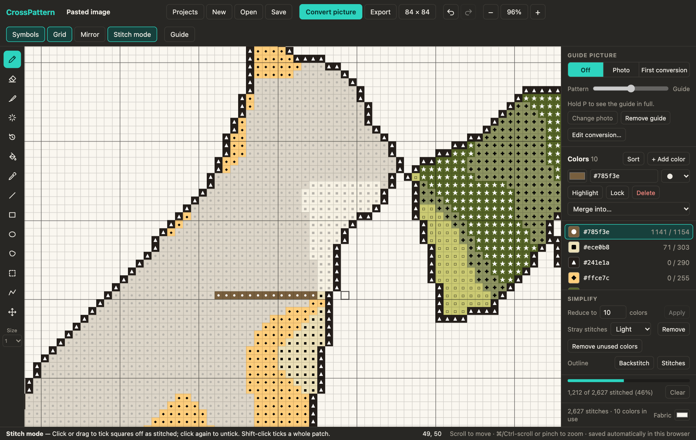

# CrossPattern

A cross stitch pattern editor that runs in your browser. Draw on a grid, or turn a photo into a pattern and
clean it up until it is something you would actually want to stitch.

**Use it here: https://lbare.github.io/CrossPattern/**

There is nothing to install and no account. Your patterns stay in your own browser; nothing is uploaded.


## What it does

- **Grid editor**: pencil, eraser, fill, line, rectangle, ellipse, select and move, and backstitch outlines.
- **Picture conversion**: crop a photo to the exact stitch count you want, then mark areas to remove, redraw
  as a cartoon, flatten to one color, or keep in detail before the colors are reduced. It is saved as you go.
- **Fine-tuning**: show the original photo over the pattern, repaint single colors, tidy noisy patches, bring
  back parts of the first conversion, or re-convert just one area with different settings.
- **Colors**: any color you like, each with a chart symbol and a live stitch count. Highlight, lock, merge,
  reduce to a set number of colors, and preview on any fabric color.
- **Stitch mode**: tick squares off as you stitch them and see your progress per color.
- **Projects**: keep as many patterns as you like in a library, and save any of them to a file.
- **Export**: a PNG of the chart, or a multi-page printable chart (also saved as PDF) with a color key.

The same guide is built into the site: press **Guide** in the top bar, or `?`.

## Using it

### Drawing

Pick a color in the panel on the right, pick a tool on the left, and click or drag on the grid. Each square is
one stitch, and bold lines mark every tenth.

| Tool | Key | What it does |
| --- | --- | --- |
| Pencil | `B` | Adds stitches in the current color. |
| Eraser | `E` | Removes stitches. |
| Recolor brush | `C` | Replaces only the color you start on, leaving everything else under the brush alone. |
| Tidy brush | `T` | Absorbs stray stitches into the colors around them, only where you brush. |
| Restore brush | `O` | Paints back stitches from the first conversion of a picture. |
| Fill | `G` | Fills a connected area. Shift-click replaces that color everywhere. |
| Pick color | `I` | Uses the color you click. Shift-click takes the exact shade from the guide photo. |
| Line | `L` | Straight line of stitches. |
| Rectangle | `R` | Outline, or filled with Shift. |
| Ellipse | `U` | Outline, or filled with Shift. |
| Select | `M` | Drag to select, drag inside to move. Flip, rotate, copy, cut, crop from the bar that appears. |
| Backstitch | `K` | Drag between grid corners to add an outline. Alt-click a line to remove it. |
| Move view | `H` | Drag to pan. Space-drag works with any tool. |

Other useful keys: `[` and `]` change brush size, `0` fits the pattern to the window, `+` and `-` zoom,
`⌘/Ctrl Z` undoes, `⌘/Ctrl A` selects everything, arrow keys nudge a selection, and holding `P` shows the guide
picture in full. **Mirror** in the top bar repeats everything you paint on the other side of the centre line.

### Converting a picture

Press **Convert picture** and choose, drop or paste an image.


1. **Crop and size.** Type the width and height in stitches. The crop box takes that shape; drag it or a corner
   to choose what goes in. You see the total stitch count and the finished size on your fabric count.
2. **Areas and colors.** Paint marks on the photo to tell the converter what matters:
   - **Remove** leaves the area as empty fabric.
   - **Cartoon** redraws an area like a drawing: lighting evened out, color strengthened, a few flat tones of
     its own, and an optional dark outline. Mark each object as its own area.
   - **One color** turns each marked area into a single solid color.
   - **Keep detail** protects the area from simplifying and gives it priority when colors are chosen.

   Marks can be made with a brush, a lasso, or a magic wand that grabs a connected area of similar color.
   The brush snaps to edges by default: paint roughly along the middle of something and the mark spreads to
   its edges and pulls back from what you overshoot. Untick "Snap to edges" for plain freehand painting.
   "Remove everything unmarked" cuts out a background in one click once the subject is marked.

   Then set the number of colors, how strongly to flatten unmarked areas, and how much to clear stray stitches.
   "Adjust the photo" lifts shadows and changes brightness, contrast and color strength first.

   Pinch or ⌘/Ctrl-scroll over the photo to zoom in for small features.

The conversion is saved as you work: close the window or refresh the page and it is still there. A pattern
also remembers the conversion it came from, so "Edit conversion" in the right panel reopens it later.

If a photo comes out as a muddy jumble (a subject in shadow, a busy background), mark each object as a
Cartoon area and remove the rest. That gives every object its own colors instead of making them compete.

A good order for a portrait or a pet: remove the background, keep detail on eyes, nose and edges, leave fur or
skin unmarked so it flattens, then lower the color count until it looks right.

### Fine-tuning afterwards

- **Guide picture** (top of the right panel): show the photo or the first conversion over your pattern, with a
  slider to fade between the two. You can also add a photo to trace over on any pattern.

  

- **Re-convert**: select an area and press Re-convert to convert just that part of the photo again.
- **Lock** a color so no tool can paint over it while you work around it.
- **Simplify**: reduce to a number of colors, remove stray stitches everywhere, or add an outline around the
  design as backstitch or stitches.
- Click the canvas size in the top bar to resize the canvas or trim empty edges.

### Stitching

Turn on **Stitch mode** and click or drag over squares as you finish them. They fade so that what is left
stands out, the palette shows stitched and total counts per color, and overall progress is shown at the bottom
of the panel. Shift-click ticks off a whole patch of one color. Progress is saved with the project.



### Projects, saving and printing

- Every pattern is a project. **Projects** opens the library, where you can switch, duplicate and delete.
- Work is saved automatically as you go.
- **Save** downloads a project file (`.crosspattern.json`). Open it, or drop it on the window, to carry on
  anywhere.
- **Export** makes a PNG. "Print or save as PDF" in the same dialog lays the chart across pages with symbols,
  row and column numbers, and a cover page with the color key and finished sizes.

## Where your data lives

Projects are stored in your browser's IndexedDB on your own computer. That means:

- Nothing is sent to a server, and nobody else can see your patterns.
- Projects do not follow you to another browser or device. Use Save and Open to move them.
- Clearing your browser's site data deletes the library. Keep project files of anything you care about.

## Limits

- Patterns can be up to 400 × 400 stitches.
- Full stitches and backstitch only; no half or quarter stitches.
- Colors are free RGB colors and are not matched to thread brands.
- It is built for a mouse or trackpad. On a phone you can open a pattern, drag and pinch to look around, and
  tick off stitches in Stitch mode; drawing and picture conversion are better on a computer.

## Running it yourself

You need [Node.js](https://nodejs.org/) 20 or newer.

```bash
npm install
npm run dev
```

Then open http://localhost:5173.

```bash
npm run build
```

builds the static site into `dist/`. It is plain static files and can be hosted anywhere.

### How it is put together

It is a Vite + React + TypeScript app with no backend and no runtime dependencies beyond React.

| File | What is in it |
| --- | --- |
| `src/model.ts` | The pattern itself: cells, palette, backstitches, and pure operations on them (fill, crop, outline, save format). |
| `src/store.ts` | App state, undo, selections, the project library, and every action the interface can take. |
| `src/CanvasView.tsx` | The drawing surface: rendering, pointer handling, and all the tools. |
| `src/render.ts` | Drawing a pattern to a canvas, for the screen, PNG export and print pages. |
| `src/convert.ts` | Picture conversion: sampling, shadow lifting, edge-preserving smoothing, cartoon areas, k-means color reduction. |
| `src/marks.ts` | The marks painted on a photo before conversion (brush, lasso, magic wand). |
| `src/ImportDialog.tsx` | The two-step picture conversion dialog. |
| `src/PalettePanel.tsx` | The right-hand panel: guide picture, colors, simplify tools, progress. |
| `src/extras.tsx`, `src/dialogs.tsx`, `src/guide.tsx` | Projects, re-convert, export, resize and the built-in guide. |
| `src/print.ts` | The multi-page printable chart. |
| `src/db.ts` | The IndexedDB project library and saved conversions. |

### Deployment

Every push to `main` is built and published to GitHub Pages by
[`.github/workflows/deploy.yml`](.github/workflows/deploy.yml).
